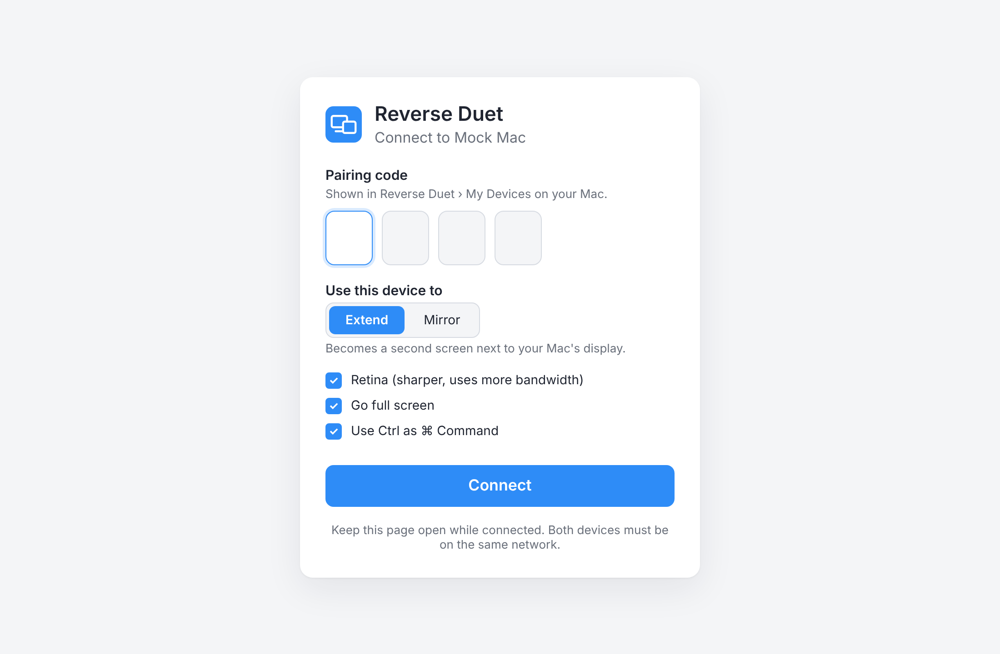
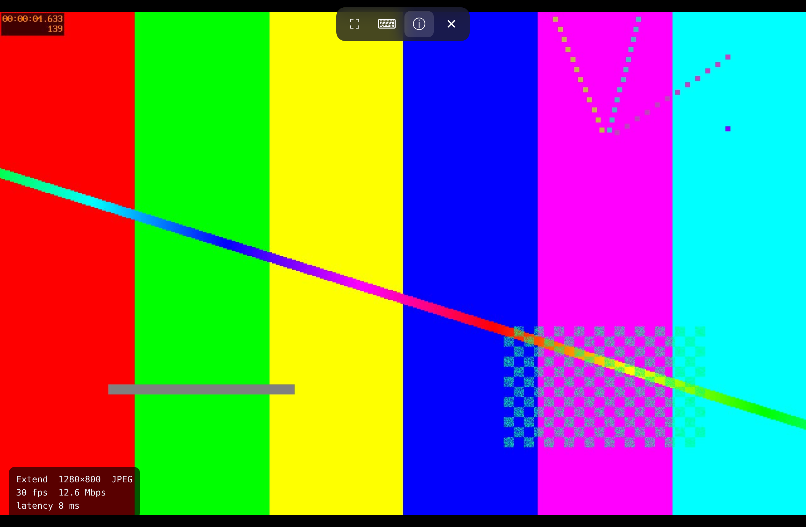

# Reverse Duet

An open-source macOS clone of [Duet Display](https://www.duetdisplay.com): turn any device with a web browser (Chromebook, Windows PC, Android or iPad tablet, another Mac) into a **second screen** for your Mac, or **mirror** your Mac onto it.

Version 1 focuses on **browser cloning**. Only the Mac needs an app; the other device opens a link in Chrome, Edge or Safari. There is nothing to install there.

| Browser: pair | Browser: streaming |
| --- | --- |
|  |  |

## Features

- **Extend**: creates a real virtual display sized to the device's screen (Retina/HiDPI optional), so you can drag windows onto it and arrange it in System Settings › Displays.
- **Mirror**: shows a copy of the Mac's main display, scaled to fit.
- **Hardware H.264** via VideoToolbox, decoded in the browser with WebCodecs. Browsers without WebCodecs automatically fall back to **JPEG**.
- **Touch, mouse and keyboard control**: tap/click, drag, right-click (two-finger tap), two-finger scroll, wheel, physical and on-screen keyboards, with an optional *Use Ctrl as ⌘* for Chromebook/Windows keyboards.
- **Per-device controls** in *My Devices*: Extend/Mirror, 30/60 fps, quality (Normal / High / Pixel Perfect), Retina, live fps / bitrate / latency, and Disconnect.
- **Pairing code**: a 4-digit code is required before a device sees your screen, limited to 5 wrong attempts per IP per minute.
- **Secure link**: an HTTPS/WSS endpoint on `port + 1` with a self-signed certificate generated on the Mac (see [below](#plain-vs-secure-link)).
- A Duet-style UI with **My Devices**, a device-type picker (ChromeOS, Windows, macOS, iOS, Android) with link, QR code and pairing code, **Settings**, **FAQ**, and a menu bar item.
- Duet's settings: Open at Login, Pause AWDL while streaming, Enable Duet Air (wireless server), Screen Sharing on/off, Prevent System Sleep. Secure Remote Login, Android USB and Audio Sharing are shown as *Coming soon*.

## Requirements

- macOS 13 Ventura or later (Apple Silicon or Intel)
- Xcode 15+ or the Swift 5.9+ command line tools
- The other device on the same Wi-Fi or Ethernet network

## Build and run

```bash
scripts/build-app.sh          # builds "build/Reverse Duet.app"
open "build/Reverse Duet.app"
```

Or, for development, `swift run ReverseDuet`. You can also open `Package.swift` in Xcode.

On first launch macOS asks for:

1. **Screen Recording** (required): System Settings › Privacy & Security › Screen Recording.
2. **Accessibility** (only for touch/keyboard control): System Settings › Privacy & Security › Accessibility.
3. **Local Network** access and possibly the firewall: allow incoming connections.

> The build script signs ad hoc by default, so macOS may ask for these permissions again after every rebuild. Set `SIGN_IDENTITY="Apple Development: you@example.com"` to keep them.

## Connecting a Chromebook (or anything else)

1. Open Reverse Duet on the Mac, then go to **My Devices › New Device › ChromeOS**.
2. On the Chromebook, open the link shown (for example `http://192.168.1.20:7280`) in Chrome, or scan the QR code.
3. Enter the pairing code, choose **Extend** or **Mirror**, and press **Connect**.

Move the mouse to the top edge, or tap there, to show the toolbar: full screen, on-screen keyboard, stats, disconnect. In Chrome, *Install app* gives a full-screen, Duet-like window.

### Plain vs. secure link

Browsers only expose WebCodecs (hardware H.264 decoding), Wake Lock and Keyboard Lock on *secure* pages, and `http://<LAN IP>` is not one. So the app serves two links:

| Link | Video | Notes |
| --- | --- | --- |
| `http://<mac>:7280` | JPEG | Works everywhere with no warnings. Uses more bandwidth. |
| `https://<mac>:7281` | H.264 (WebCodecs) | Smoother and lighter. Accept the one-time certificate warning (*Advanced › Proceed*). |

The certificate is created once by `/usr/bin/openssl` and stored in `~/Library/Application Support/Reverse Duet/tls/`. Turn it off with *Settings › Secure Link (HTTPS)*.

## How it works

```
 Mac (Reverse Duet.app)                                   Other device (browser)
 ┌──────────────────────────────────────────────┐        ┌───────────────────────────┐
 │ CGVirtualDisplay (Extend) / main display      │        │ index.html + app.js       │
 │        │                                       │        │                           │
 │ ScreenCaptureKit ─► VideoToolbox H.264 ──┐     │  WS    │ WebCodecs VideoDecoder ─► │
 │                   └► CoreImage JPEG ─────┼─────┼───────►│ createImageBitmap ──► canvas
 │                                          │     │        │                           │
 │ CGEvent injection ◄── input JSON ◄───────┘     │◄───────│ pointer / wheel / keys    │
 │ Network.framework HTTP + WebSocket server       │        │                           │
 └──────────────────────────────────────────────┘        └───────────────────────────┘
```

- `Sources/ReverseDuet/App`: app entry point, menu bar extra, `AppState`.
- `Sources/ReverseDuet/UI`: the SwiftUI screens (sidebar, My Devices, Settings, FAQ).
- `Sources/ReverseDuet/Streaming`: HTTP/WebSocket server, per-client sessions with flow control, capture pipeline, encoders, input injection.
- `Sources/ReverseDuet/Core`: models, settings, TLS identity, system helpers (sleep assertion, AWDL, login item, permissions, QR codes).
- `Sources/CGVirtualDisplayBridge`: Objective-C wrapper around the private `CGVirtualDisplay` API used for Extend mode.
- `Sources/ReverseDuet/Web`: the browser client.
- [`docs/PROTOCOL.md`](docs/PROTOCOL.md): the wire protocol.

## Working on the browser client without a Mac

`tools/mock-server.mjs` speaks the same protocol and streams an ffmpeg test pattern (needs Node 18+ and ffmpeg):

```bash
node tools/mock-server.mjs --codec jpeg --code 1234   # or --codec h264
# open http://localhost:7280 and enter 1234; input events are printed as JSON
```

## Roadmap

- v1 (this): browser clients over Wi-Fi/LAN, Extend and Mirror, H.264/JPEG, touch/keyboard control.
- Next: audio sharing (ScreenCaptureKit audio → Web Audio), native iPad/Android receivers, USB connections, a multi-display picker for Mirror, Apple Pencil pressure, and an MSE (fMP4) H.264 path for insecure origins.

## Disclaimer

Independent open-source project, not affiliated with or endorsed by Duet, Inc. "Duet" and "Duet Air" are referenced only to describe the feature set being reproduced.
